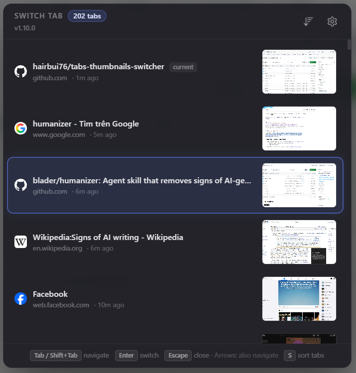
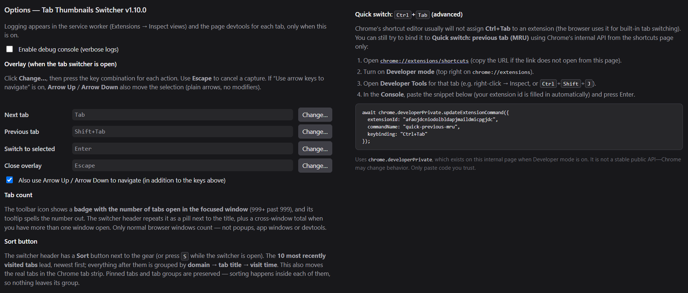

# Tab Thumbnails Switcher

A Chrome extension that switches tabs using **most recently used (MRU)** order, with **thumbnail** previews in an overlay when you use the long-press gesture or the toolbar button.

## Screenshots



*Figure 1 — Tab switcher overlay. The tab-count pill and version sit beside the title, Sort and settings top right. Each row carries a favicon, title, domain and last-visit stamp, and a thumbnail; the current tab is tagged and the selection is outlined. Keyboard hints run along the bottom.*



*Figure 2 — Options page. Left: debug logging toggle, the four rebindable overlay keys, and what the tab count and Sort button do. Right: the advanced Ctrl+Tab console snippet with your extension id filled in.*

## Installation

1. Clone or download this repository
2. Open `chrome://extensions/` in Chrome
3. Enable **Developer mode** (toggle in the top-right corner)
4. Click **Load unpacked** and select this folder
5. The extension is now active

Besides `tabs`, `storage` and friends, the extension asks for `system.memory`, to read the machine's free memory for the [Sleep](#sleep) figure, and `sessions`, so Undo can bring closed tabs back from Chrome's recently-closed list with their history. Because `sessions` comes together with `tabs`, Chrome's install (or update) prompt warns that it can **"Read your browsing history on all your signed-in devices"**. The extension only ever reads the recently-closed list, to find the tabs it closed itself.

## Options (debug console)

- Right-click the extension icon → **Options**, or from `chrome://extensions` open **Extension options** for this extension.
- **Enable debug console (verbose logs)** — when off, `[TTS …]` logs are suppressed in the service worker and in page devtools. Default is off.
- **Overlay (when the tab switcher is open)** — set **Next / Previous / Switch to selected / Close** by clicking **Change…** and pressing a key (modifiers like Shift / Ctrl are captured). **Escape** cancels capture. The hint bar in the switcher uses these labels. You can also enable **Arrow Up / Arrow Down** for navigation in addition to your custom keys (default: on, same as the old behavior).
- **Quick switch: Ctrl+Tab (advanced)** — step-by-step instructions and a console snippet with your **extension id** already filled in (same idea as in [Binding Tab shortcuts](#binding-tab-shortcuts)).

## Keyboard shortcuts (`chrome://extensions/shortcuts`)

1. Open `chrome://extensions/shortcuts` and find **Tab Thumbnails Switcher**.
2. Suggested defaults (remap with the pencil if you like):
   - **Quick switch: previous tab (MRU) — no menu** — default **Ctrl+Shift+E**
   - **Open tab switcher (thumbnail menu)** — default **Ctrl+Shift+Q** (same chord as the in-page long-press; see `key-gesture.js`)
3. The manifest defines these in [`manifest.json`](manifest.json) under `commands`.

**Ctrl+Tab:** The normal shortcuts UI usually will not assign **Ctrl+Tab** to an extension (Chrome reserves it). See [Binding Tab shortcuts](#binding-tab-shortcuts) below for the console workaround, or use **OS-level remapping** to send your chosen shortcut.

### When the overlay is open

| Key | Action |
|-----|--------|
| **Gear** (header, top right) | Opens the extension **options** page in a new tab. |
| **Tab count** (header, next to the title) | How many tabs are open — see [Tab count](#tab-count). |
| **Sort** (header, left of the gear) | Reorders the list **and the real Chrome tab strip** — see [Sorting](#sorting). |
| S | Same as the Sort button |
| **Sleep N** (header) / Z | Puts background tabs to sleep — see [Sleep](#sleep). |
| **Dedupe N** (header) / D | Closes duplicate tabs, with Undo — see [Duplicate tabs](#duplicate-tabs). Shown only when there is something to close. |
| **Tidy up** (header) / T | Goes through the tabs one at a time — see [Tidy-up](#tidy-up). |
| Tab / Arrow Down | Move selection down |
| Shift+Tab / Arrow Up | Move selection up |
| Enter | Switch to selected tab |
| Escape | Close the switcher |
| Click a row | Switch to that tab |

S, Z, D and T are plain letters with no modifier. If one of your configured keys (next, previous, switch, close) is bound to the same letter, that binding wins and the shortcut is skipped.

### Switch on modifier release (Alt+Tab style)

Off by default; turn it on in **Options → Overlay**. With it on, the switcher works like the Windows Alt+Tab dialog: **keep holding** the shortcut that opened it, cycle, then **let go of Ctrl to switch**. Enter and Escape keep working.

To cycle while holding, either **tap the open shortcut again** — with `Ctrl+Shift+Q`, keep Ctrl+Shift down and tap <kbd>Q</kbd> — or press <kbd>&darr;</kbd> / <kbd>&uarr;</kbd>. For the real thing, with <kbd>Tab</kbd> as the cycle key, see [Binding Tab shortcuts](#binding-tab-shortcuts).

**<kbd>Tab</kbd> pressed as a plain keystroke cannot cycle, and cannot be made to.** Chrome reserves `Ctrl+Tab` and `Ctrl+Shift+Tab` for its own tab switching and [never dispatches them to a page](https://lists.w3.org/Archives/Public/public-webapps-github/2016Jan/0255.html) — deliberately, so that a page cannot trap a keyboard-only user by swallowing every key. Firefox delivers them and ignores `preventDefault`; Chrome, Safari and Edge deliver nothing. The way around it is to bind `Ctrl+Shift+Tab` as a *command*, which arrives through the extension API rather than the page.

**What triggers the commit.** Any of Ctrl, Alt or Meta going up, once the switcher has been opened from the keyboard. The extension also tries to work out the exact chord — it asks Chrome what the shortcut is bound to (`chrome.commands.getAll`) and watches observed key state — but that is a refinement, not a requirement. It cannot be a requirement: Chrome consumes the keydown of its own command chords, so with `Ctrl+Shift+Q` as the cycle key the page never sees one keydown with Ctrl held, and if it also missed the bare Ctrl keydown — focus in the omnibox, say — it has no idea anything is held. Gating the commit on identifying the chord meant that whenever identification failed, releasing did nothing at all.

Opening the switcher by **clicking the toolbar icon** does not arm anything, so a stray Ctrl press cannot switch tabs behind your back.

The rest of the details:

- Cycling by re-tapping the shortcut only moves **forwards**; the chord already contains Shift, so there is no reversed variant of it. Use <kbd>&uarr;</kbd> to go back.
- **Shift is never the commit key.** It has to stay free to tell "previous" from "next", so `Ctrl+Shift+Q` arms on Ctrl alone and releasing Shift does nothing. For the same reason the arrows accept Shift while armed: the chord holds it down anyway, and up/down need no Shift to tell them apart.
- The held modifier is masked out when matching bindings, so a binding of plain <kbd>J</kbd> still fires while you hold Ctrl.
- The overlay takes DOM focus when it opens, so the keyup that commits lands on the document rather than in an input or iframe that held focus before.
- Detecting the release needs the page to receive the keyup, so it does not work on `chrome://` pages, the Web Store, or the PDF viewer, where content scripts never run — nor if the page has no keyboard focus at all. Turn on the debug console in Options and watch for `keyup` lines in the page devtools: no lines at all means the page is not receiving key events, which is the one case nothing here can fix.
- `Alt+Tab` cannot be the trigger: the `commands` API does not accept `Tab` as a shortcut key through the normal UI, and Windows and most Linux desktops grab Alt+Tab before Chrome sees it. Alt is a poor hold key on Windows anyway, where tapping it moves focus to Chrome's toolbar.

## Tab count

The **toolbar icon carries a badge** with the number of tabs open in the focused window, repainted as tabs open, close, move between windows, or when you switch windows. Past 999 it reads `999+`. The icon's tooltip spells the same number out, next to the version.

The switcher header shows it too: a **`12 tabs`** pill next to the title, taken from the list on screen so the two can never disagree. When more than one window is open, a muted line under it adds the cross-window total — `30 tabs in 3 windows`. Hover the pill for both numbers at once.

Only normal browser windows are counted; popups, app windows and devtools carry tabs of their own that nobody thinks of as open tabs.

## Sorting

The **Sort** button in the switcher header (or **S** while it is open) applies one combined order:

**The 10 most recently visited tabs lead**, newest first — the window's global top 10, so what you were just working on stays within reach.

**Everything after them** is sorted by:

1. **Domain** (A→Z) — tabs of the same site end up next to each other.
2. **Tab title** (A→Z) — within one site.
3. **Newest visit first** — only as a tie-break on identical titles.

This is not just a view: the **real Chrome tab strip is reordered** to match, via `chrome.tabs.move`, and the switcher then shows the new strip order.

Tabs never leave the run they belong to, so nothing gets scrambled:

- **Pinned tabs** are sorted among themselves and stay in front. They are excluded from the recent-10 head, since they already sit at the front permanently and would otherwise starve the rest of the strip of head slots.
- **Tab groups** stay intact and in place — sorting happens inside each group.
- Each stretch of **ungrouped** tabs is sorted within itself. With no tab groups (the common case) that is the whole strip, so the sort is global.

The recent head is picked once per window, then each run leads with whichever of those tabs it happens to contain — so you get one top 10 overall, not a top 10 per group. Tabs never activated in this session have no visit time, are not eligible for the head, and land at the end of their site block.

## Sleep

The **Sleep N** button in the switcher header (or **Z** while it is open) puts the background tabs of the current window to sleep: Chrome discards each one (`chrome.tabs.discard`), which frees the memory its page was using. A sleeping tab stays in the tab strip and in the switcher, keeps its thumbnail, and carries a **💤** marker. Open it and Chrome reloads the page.

N is the number of tabs that would go to sleep. These are left awake:

- **The current tab** — you are looking at it.
- **Pinned tabs** — usually mail or chat, which should keep receiving.
- **Tabs playing sound** — music or a call would stop.
- **Tabs already asleep** — nothing left to free.
- **Tabs Chrome marks as not auto-discardable** — you (on `chrome://discards`) or another extension asked Chrome to keep them alive.

At zero the button is disabled.

On the muted line under the title, the header shows a memory line — **`RAM: 2.9 GB free of 16 GB`** — read from `chrome.system.memory`. If Chrome cannot report memory, the line is hidden.

After a sleep the switcher redraws in place and a line at the bottom says what happened: `Put 12 tabs to sleep · freed ~1.8 GB`. Tabs Chrome refused to discard are counted at the end (`· 2 could not sleep`).

Take the GB figure with a pinch of salt. Chrome gives extensions no per-tab memory figure, so it is the machine's **free memory before the sleep versus about 1.5 seconds after** — the change across the whole computer, not just Chrome. Other applications allocating or freeing memory in that window move it either way. When free memory did not go up (by at least 0.1 GB), no figure is shown, rather than a zero, a negative number or an estimate.

## Duplicate tabs

Two tabs are **duplicates** when they show the same page: the same URL once the `#fragment` is dropped. The query string still counts, so `?page=2` and `?page=3` are different pages. Only the current window is looked at, the same tabs the switcher lists. Blank tabs (`about:blank`, or a tab still loading with no URL yet) are never duplicates of each other.

Every copy of a duplicated page carries a **×N** badge next to its title, N being how many tabs show that page.

The **Dedupe N** button (or **D**) closes all copies but one. N is how many tabs would close; the button only appears when that is more than zero. The copy that stays is:

1. **the current tab**, if it is one of them, else
2. **a pinned copy**, else
3. **the most recently used copy**.

The current tab and pinned tabs are **never closed**, so two pinned copies of the same page both stay. The list is worked out again from the live tabs when you press the button, not taken from what the switcher was showing.

Afterwards the switcher redraws and a line at the bottom reads `Closed 7 duplicate tabs — the newest copy stays open`, with an **Undo** button, for about 8 seconds.

**Undo** brings the closed tabs back where they were. Each one is restored from Chrome's recently-closed list (`chrome.sessions`, the same list **Ctrl+Shift+T** uses), which keeps its back/forward history. Chrome keeps only the **25 most recent** closed tabs and windows there, so if you have closed a lot since, the older ones are no longer listed: those are reopened by URL in a fresh tab, without history. After Undo the tab you were on stays active.

The extension remembers the **last 20** Dedupe and tidy-up closes it can undo, for the rest of the browser session. They are stored rather than kept in memory, so Undo still works after Chrome has stopped the idle service worker; they are gone once the browser closes.

## Tidy-up

The **Tidy up** button (or **T**) swaps the list for a single large card and walks you through this window's tabs **one at a time**, so a long row of forgotten tabs can be dealt with by keyboard. Each card shows the thumbnail, title, site, last visit and the 💤 / ×N markers; a counter above it reads `37 left`.

Tabs come **least recently visited first**, by the last-visit time Chrome keeps for each tab; a tab with no visit time at all comes before the rest. The current tab and pinned tabs are not included.

| Key | Action |
|-----|--------|
| X | Close the tab, go to the next |
| K | Keep it, go to the next |
| Z | Put it to sleep, go to the next |
| U | Undo the last step — reopens a closed tab, or steps back to the card you kept or slept |
| Enter | Switch to that tab and close the switcher |
| Escape | Leave tidy-up, back to the list |

The keys are fixed and take no modifier. Your configured close key leaves tidy-up too; the other switcher keys (navigation, S, D) do nothing until you are back in the list, and the Sleep and Dedupe buttons are disabled meanwhile.

**Z in tidy-up** sleeps the tab on the card even when the **Sleep N** button would leave it alone — one playing sound, say, or one marked not auto-discardable — because you picked that tab yourself. It shows no memory figure.

**U** steps back through what you did. Undoing a close reopens the tab the same way the Dedupe Undo does, history included; undoing a keep or a sleep just brings the card back (a slept tab stays asleep).

At the end of the queue a summary replaces the card — `Closed 12 · kept 20 · slept 5` — with a button back to the list (Enter does the same). If there was nothing to go through, tidy-up opens straight onto that summary.

The rest of the details:

- Every key acts at once; leaving halfway keeps whatever you did, and the list redraws with it.
- A tab you closed elsewhere while tidying is skipped without a word. An action Chrome refuses leaves the card where it is with a short error; press K to move past it.
- One action at a time: a fast double press cannot close two tabs.
- With [switch on modifier release](#switch-on-modifier-release-alttab-style) on, entering tidy-up **disarms** it: letting go of Ctrl mid-triage never switches tabs, and back in the list it stays off until every modifier has been let go. Sleep and Dedupe disarm it the same way.
- The queue and what you did live in the switcher only; close the switcher and tidy-up starts over next time.

## Binding Tab shortcuts

Chrome's shortcut editor will not assign anything containing <kbd>Tab</kbd> to an extension: the `commands` API does not accept `Tab` as a shortcut key at all (the allowed set is A–Z, 0–9, Comma, Period, Home, End, PageUp, PageDown, Space, Insert, Delete, the arrow keys and media keys). Chrome's **internal** API will, from the shortcuts page.

The **Options** page generates these snippets with your extension id already filled in, and shows what each command is bound to right now. To run one by hand:

1. Open `chrome://extensions/shortcuts`, with **Developer mode** on (toggle on `chrome://extensions`).
2. Open **Developer Tools** for that tab (right-click → Inspect, or **Ctrl+Shift+J**).
3. Paste into the **Console** and press Enter, replacing `YOUR_EXTENSION_ID` with the id shown under this extension on `chrome://extensions`:

```js
// Ctrl+Tab jumps straight to the previous tab.
await chrome.developerPrivate.updateExtensionCommand({
  extensionId: "YOUR_EXTENSION_ID",
  commandName: "quick-previous-mru",
  keybinding: "Ctrl+Tab"
});

// Ctrl+Shift+Tab opens the switcher, and taps of Tab then walk it.
await chrome.developerPrivate.updateExtensionCommand({
  extensionId: "YOUR_EXTENSION_ID",
  commandName: "open-tab-switcher",
  keybinding: "Ctrl+Shift+Tab"
});
```

That pair is the arrangement worth having. With [switch on modifier release](#switch-on-modifier-release-alttab-style) turned on it reproduces Alt+Tab exactly: hold <kbd>Ctrl</kbd>+<kbd>Shift</kbd>, tap <kbd>Tab</kbd> to walk the list, let <kbd>Ctrl</kbd> go to jump. Cycling with <kbd>Tab</kbd> works **only** when bound this way, for the reason above — as a plain keystroke it never reaches the extension.

The command names are `quick-previous-mru` (no menu) and `open-tab-switcher` (thumbnail menu, and the cycle key while the menu is up). Change `keybinding` to whatever you like.

This calls `chrome.developerPrivate`, which exists on that internal page when Developer mode is on. It is **not** a stable public API — Chrome may change or remove it. Only run snippets you trust. To undo, rebind to something ordinary or press **Reset** next to the shortcut on `chrome://extensions/shortcuts`.

Failing all that, **OS-level remapping** (Windows AutoHotkey and friends) can map any chord onto whatever you assigned in `chrome://extensions/shortcuts`.

## How it works

- **MRU** — The background script tracks the order you activate tabs; “previous” tab is the second entry in that list.
- **Quick switch** — The `commands` entry `quick-previous-mru` calls the same MRU “previous tab” action from the service worker (no overlay).
- **Thumbnails** — The visible tab is captured (JPEG) when it becomes active; that image is used in the switcher.
